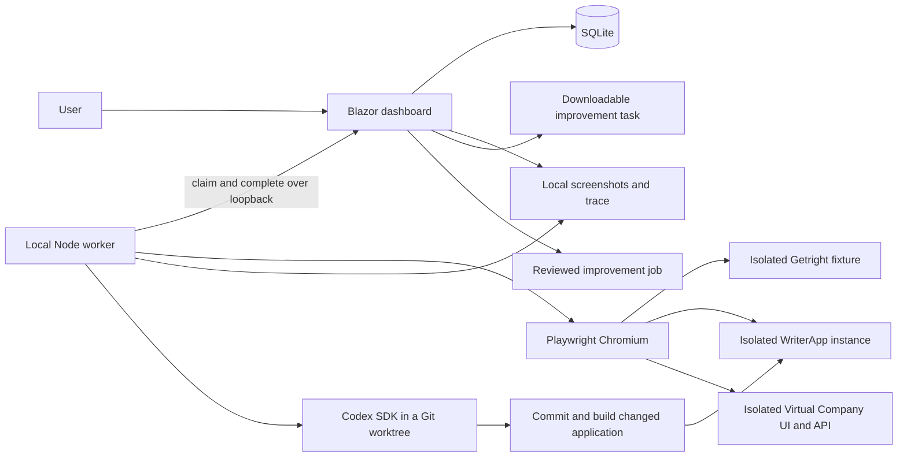

# Architecture

## Planned configuration-driven integrations

[Roadmap milestones 5–10](roadmap.md#configuration-driven-integration-plan) propose
versioned JSON application manifests, declarative browser/API workflows and
trusted local build/launch recipes around the shared run/job lifecycle. Registered,
versioned extensions cover interactions and host infrastructure outside the shared
action vocabulary. Resolved non-secret definitions and execution versions become
part of immutable run attribution. General application manifests and configurable
host recipes remain planned. The current implementation uses fixed application
fixtures and host adapters, with a bounded browser vocabulary for approved cases.

## Current implementation



`src/Getright.Dashboard` hosts interactive server-rendered pages and a small JSON
API. `RunStore` serializes mutations and uses SQLite WAL with parameterized SQL.
Before constructing RunStore, the process holds an exclusive-writer file handle
in its data directory. A second dashboard cannot perform restart recovery on a live
instance's leases, including when it attempts to bind a different port. The OS
releases ownership on process exit; retained metadata needs no manual deletion.
Schema version 6 retains runs, feedback, application profiles, improvement jobs,
events, heartbeat expiry, review audit and cleanup journals. Startup
migrates schemas 1–5 transactionally, preserving legacy payloads. Newer
schemas are rejected instead of being downgraded. Future changes require migrations.

Schema 5 adds suites, draft case definitions and generation proposals. Initial
suites reference existing catalogue IDs; generated cases have new stable IDs and
step IDs. Runs retain their frozen definition independently of suite membership.
The explicit OpenAI generation action produces a persisted, editable proposal;
only a separate apply action appends draft cases atomically. Generated text cannot
enable an adapter. Server-side generation is bounded, uses a strict Responses JSON
schema and handles refusal/truncation/failure without adding cases. Only the feature,
suite name and application name are sent. The key stays in server configuration.
See [test suites](test-suites.md) for the boundary and contracts.

Schema 6 adds test-implementation jobs/events and verified workflow bindings. An
explicit approval freezes the case definition digest and clean application source
receipt. Approval does not depend on the original manual-review host remaining
online. Codex writes one bounded JSON artifact in a separate Getright worktree;
the worker retains its base and resulting local commit. Fixed host adapters build
the approved application revision in a separate worktree. Two validation runs
must pass with distinct fixtures/resources on the verified fresh runtime before a
binding is atomically enabled.
The binding freezes the raw plan digest, execution-engine digest, application
source commit and proof runs. Normal queues require that source revision and a
worker with the verified engine. Neither approval nor verification accepts an
application run. See [test implementation](test-implementation.md).

`config/catalog.json` is copied into the dashboard build and published output.
Rebuild after editing it. Test definitions are snapped into queued runs, so later
catalogue edits cannot change historical reproduction steps. The server and
worker allowlist executable adapters; simply changing a draft flag cannot make
an unimplemented test execute.

`worker/src/index.mjs` claims and runs one job at a time. It has no inbound HTTP
listener or shell-command endpoint. Codex proposes bounded declarative browser
actions during explicit implementation; normal runs interpret the verified plan
without a model call. The demo and fixture setup use trusted source code.
A fresh browser context isolates each run.
Step screenshots and a Playwright trace are written to the shared evidence root
before completion is submitted. Failed launches and browser failures report a
failed run; they do not manufacture passing steps or human acceptance.

`worker/src/launch.mjs` supervises the worker child. A startup source/dependency
stamp is checked before each queue claim; changed source makes the idle child
request a reload instead of continuing with cached modules. The supervisor only
restarts that explicit reload exit, not ordinary failures. Active jobs and manual
browser review finish first. Supervisor loss stops its child and owned operations.

Normal dashboard restart refuses queued/active work. An explicit `-PreserveQueued`
upgrade, with workers stopped, allows a complete inventory of unclaimed
test-implementation jobs to survive a reload. Executing implementations and other
work still block it. This avoids making an old worker's unclaimed queue prevent
the dashboard/worker upgrade required to service it.

For standalone visible runs, tracing stops and the dashboard acknowledges the
terminal result before manual review begins. The worker retains that browser and
waits until its last page closes or the worker stops. Review has no active run
lease or automation deadline; manual actions cannot change the stored result,
evidence or acceptance. Headless runs, explicit auto-close mode and job-owned
regressions close their browsers automatically. Job hosts retain their existing
bounded lifecycle.

The running dashboard's assembly informational version identifies the demo build.
.NET includes the source revision when building from a committed Git checkout.
This identifies the local fixture. The WriterApp launcher supplies a unique
assembly version and retains a source receipt; preflight checks its actual version
endpoint and development identity. Runs freeze that profile, and the worker checks
it again before creating data and after the workflow. Passing completions must
match the frozen target/build/account and include the created resource identity.
The source receipt records if the source was dirty; a commit hash alone does not
identify those uncommitted changes. The milestone 2 worker builds clean source in
a new worktree, commits its change, assigns a job-specific assembly version and
verifies the actual runtime before rerunning the original test. Build changes to
tracked source fail attribution checks.

## Data and state

```text
data/
  getright.db             # runs, feedback, profiles, jobs, suites, proposals and bindings, schema version 6
  keys/                   # local ASP.NET keys, protected with DPAPI on Windows
  evidence/<run-id>/
    open.png
    edit.png
    save.png
    reopen.png
    trace.zip
  writerapp/<instance-id>/ # isolated WriterApp database, config and build receipt
  jobs/<job-id>/          # bounded logs, diff, summary and changed host data
  case-implementations/<job-id>/ # bounded logs, workflow copy, summary and validation host data
```

Automated state: `queued → running → passed | failed | cancelled | interrupted`.

Acceptance state: `pending | accepted | improvements-requested`.

Review decisions apply only to completed runs. Adding feedback marks that run as
improvements requested in the same transaction as feedback persistence. Reviews
can be changed; test results, test snapshots and existing feedback are retained.
Each new run starts pending. Review and feedback-induced decision changes append
transactional audit events. History is paginated; Home displays the latest 12 runs
per test. Metadata remains in SQLite after explicitly selected evidence cleanup.

The control room places a quick-review panel above Workflow detail. Its actions
reuse the same review, feedback and improvement-job store methods as full review.
The displayed run ID is pinned while newer runs arrive; switching is explicit and
clears unsaved comment fields. Step choices come from that run's frozen snapshot.
Inline task edits retain their revision and require reload on concurrent edits;
preparing a task never starts implementation. Only Implement improvement queues it.

Claims use a private lease that is never returned by ordinary run reads. Duplicate
claims, mismatched leases, duplicate completions and incomplete passing results
are rejected. Dashboard restart invalidates running leases. Run, job and cleanup leases expire after 45 seconds and renew every five seconds.
A background monitor recovers expired leases. Standalone runs have a bounded
deadline and cancel their browsers on shutdown, cancellation or lost ownership.

## Trust boundary

This is a **single trusted local user's development tool**. The server validates
loopback peers, loopback Host headers and same-origin browser requests, including
WebSocket origins. The worker accepts only a loopback HTTP dashboard origin.
Evidence routes serve only files referenced by that run. Files are not exposed as
a general static directory. No arbitrary command, repository path or script can
be submitted through the API.

Local processes with access to the dashboard and data directory are trusted. The
lease is a concurrency control, not user authentication. The application is not
suitable for LAN access, reverse-proxy publishing or multi-user hosting without
authentication, authorization, CSRF/session design and authenticated worker leases.

Evidence and traces can contain application content and session data. Keep them
in ignored local storage, use dedicated UAT accounts, and sanitize any exported
material before sharing. GitHub Actions runs the isolated demo and synthetic job
contracts; live Codex/WriterApp validation is opt-in and its evidence is not uploaded.

## Codex job execution

Feedback can create a revisioned draft; the explicit Implement action queues it.
The worker uses the [official Codex SDK](https://learn.chatgpt.com/docs/codex-sdk)
with the existing local sign-in, workspace-write permissions, disabled command
network access and no automatic escalation. Task text is not a command template.
Repository selection and the application build/launch adapters come from trusted
local configuration and fixed worker source.

The worker validates the original clean source revision, creates a short dedicated
worktree outside the original checkout, streams Codex events, commits its source
diff locally and runs bounded build/launch commands. A changed app gets a fresh
database and is stopped after its regression test. Worktrees, branches, evidence
and logs are retained for review. No merge, deployment or publish step exists.

Rerun creation and its job link are saved atomically, using the original frozen
test definition. The runtime version, resulting source commit and verified account
must match the rerun target. Automated success moves the job to awaiting-review;
it never accepts the application change on the user's behalf.

Job leases last 45 seconds and are renewed every five seconds. Cancellation aborts
owned operations; shutdown, restart and lost leases retain an interrupted job.
Any owned in-flight regression run becomes interrupted and rejects stale completion.
Standalone UAT and cleanup tasks also use renewable leases. See
[improvement jobs](improvement-jobs.md) for the lifecycle and validation scope.

Virtual Company uses the same run/job contract with optional company and role fields.
Its Getright-owned host composes the actual API through the repository test factory
and a fresh in-memory SQLite database, with a real Blazor Web UI. A local gateway
checks the owned Web binary and forwards Blazor WebSockets. See
[Virtual Company UAT](virtual-company-uat.md) for runtime attribution and limits.

[Local operations](operations.md) describes paginated review, comparisons, child
process ownership, explicit retention and Git worktree cleanup boundaries.
