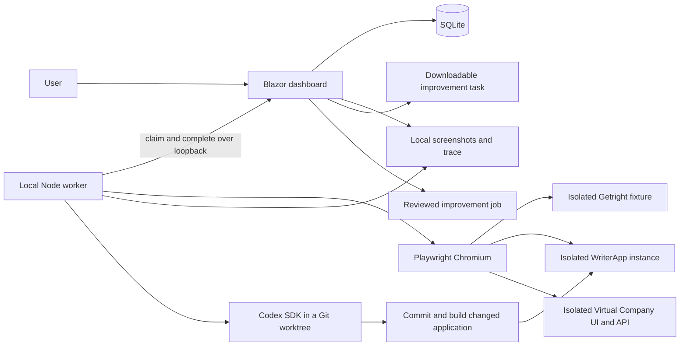

# Architecture

## Current implementation



`src/Getright.Dashboard` hosts interactive server-rendered pages and a small JSON
API. `RunStore` serializes mutations and uses SQLite WAL with parameterized SQL.
Schema version 3 retains runs, feedback and application profiles, and adds
improvement jobs, incremental events and private expiring job leases. Startup
migrates schemas 1 and 2 transactionally, preserving legacy payloads. Newer
schemas are rejected instead of being downgraded. Future changes require migrations.

`config/catalog.json` is copied into the dashboard build and published output.
Rebuild after editing it. Test definitions are snapped into queued runs, so later
catalogue edits cannot change historical reproduction steps. The server and
worker allowlist executable adapters; simply changing a draft flag cannot make
an unimplemented test execute.

`worker/src/index.mjs` claims and runs one job at a time. It has no inbound HTTP
listener, shell-command endpoint or model-driven browser action selection. The
demo adapter is repeatable source code. A fresh browser context isolates each run.
Step screenshots and a Playwright trace are written to the shared evidence root
before completion is submitted. Failed launches and browser failures report a
failed run; they do not manufacture passing steps or human acceptance.

The running dashboard's assembly informational version identifies the demo build.
.NET includes the source revision when building from a committed Git checkout.
This identifies the local fixture. The WriterApp launcher supplies a unique
assembly version and retains a source receipt; preflight checks its actual version
endpoint and development identity. Runs freeze that profile, and the worker checks
it again before creating data and after the workflow. Passing completions must
match the frozen target/build/account and include the created resource identity.
The source receipt records if the source was dirty; a commit hash alone does not
identify those uncommitted changes. The milestone 2 worker builds clean source in
a new worktree, commits its change, assigns a job-specific assembly version and
verifies the actual runtime before rerunning the original test. Build changes to
tracked source fail attribution checks.

## Data and state

```text
data/
  getright.db             # runs, feedback, profiles, jobs and events, schema version 3
  keys/                   # local ASP.NET keys, protected with DPAPI on Windows
  evidence/<run-id>/
    open.png
    edit.png
    save.png
    reopen.png
    trace.zip
  writerapp/<instance-id>/ # isolated WriterApp database, config and build receipt
  jobs/<job-id>/          # bounded logs, diff, summary and changed host data
```

Automated state: `queued → running → passed | failed | interrupted`.

Acceptance state: `pending | accepted | improvements-requested`.

Review decisions apply only to completed runs. Adding feedback marks that run as
improvements requested in the same transaction as feedback persistence. Reviews
can be changed; test results, test snapshots and existing feedback are retained.
Each new run starts pending. Review audit history and feedback editing are future
work. History displays the latest 12 runs per test; all runs remain in SQLite.

Claims use a private lease that is never returned by ordinary run reads. Duplicate
claims, mismatched leases, duplicate completions and incomplete passing results
are rejected. Dashboard restart invalidates running leases. Claims sweep work
older than ten minutes into interrupted. Standalone UAT runs have no heartbeat or
automatic retry yet, so their adapters must stay within the lease duration.

## Trust boundary

This is a **single trusted local user's development tool**. The server validates
loopback peers, loopback Host headers and same-origin browser requests, including
WebSocket origins. The worker accepts only a loopback HTTP dashboard origin.
Evidence routes serve only files referenced by that run. Files are not exposed as
a general static directory. No arbitrary command, repository path or script can
be submitted through the API.

Local processes with access to the dashboard and data directory are trusted. The
lease is a concurrency control, not user authentication. The application is not
suitable for LAN access, reverse-proxy publishing or multi-user hosting without
authentication, authorization, CSRF/session design and authenticated worker leases.

Evidence and traces can contain application content and session data. Keep them
in ignored local storage, use dedicated UAT accounts, and sanitize any exported
material before sharing. GitHub Actions runs the isolated demo and synthetic job
contracts; live Codex/WriterApp validation is opt-in and its evidence is not uploaded.

## Codex job execution

Feedback can create a revisioned draft; the explicit Implement action queues it.
The worker uses the [official Codex SDK](https://learn.chatgpt.com/docs/codex-sdk)
with the existing local sign-in, workspace-write permissions, disabled command
network access and no automatic escalation. Task text is not a command template.
Repository selection and the application build/launch adapters come from trusted
local configuration and fixed worker source.

The worker validates the original clean source revision, creates a short dedicated
worktree outside the original checkout, streams Codex events, commits its source
diff locally and runs bounded build/launch commands. A changed app gets a fresh
database and is stopped after its regression test. Worktrees, branches, evidence
and logs are retained for review. No merge, deployment or publish step exists.

Rerun creation and its job link are saved atomically, using the original frozen
test definition. The runtime version, resulting source commit and verified account
must match the rerun target. Automated success moves the job to awaiting-review;
it never accepts the application change on the user's behalf.

Job leases last 45 seconds and are renewed every five seconds. Cancellation aborts
owned operations; shutdown, restart and lost leases retain an interrupted job.
Any owned in-flight regression run becomes interrupted and rejects stale completion.
The normal UAT queue retains its separate ten-minute run lease. See
[improvement jobs](improvement-jobs.md) for the lifecycle and validation scope.

Virtual Company uses the same run/job contract with optional company and role fields.
Its Getright-owned host composes the actual API through the repository test factory
and a fresh in-memory SQLite database, with a real Blazor Web UI. A local gateway
checks the owned Web binary and forwards Blazor WebSockets. See
[Virtual Company UAT](virtual-company-uat.md) for runtime attribution and limits.
