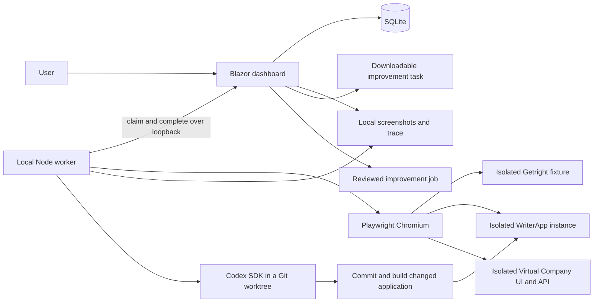

# Architecture

## Application manifests and run configuration

`config/application-manifests.json` is copied with the catalogue into the build.
Each application has one schema-1 manifest with a revision, fixture adapter,
supported adapter versions, manual review entry path and capabilities. Rebuild
and restart to apply edits to future runs. The dashboard validates definitions
at startup. A manifest can include a versioned runtime plan. The registered
adapters still check their own target and run their existing browser workflows.
Application manifests can select a versioned build recipe for implementation.

Normal runs and case validation runs retain the resolved manifest, workflow and
target binding. Fingerprints identify the manifest, full workflow snapshot and
binding (including fixture and execution mode). Linked improvement reruns retain
the original manifest and workflow; only their new isolated target, fresh fixture
and automatic run mode are rebound. For a legacy parent without a manifest, the
rerun uses the current compatible manifest and keeps the original workflow.

The worker advertises the supported snapshot protocol and its engine fingerprint.
Verified workflows additionally require their exact engine fingerprint at claim.
The run process checks compatibility before starting the browser. Built-in
adapter versions and the verified workflow engine files are unchanged. New runs
record the worker identity at claim or direct start. Worker-local settings such
as browser visibility and job build timeouts are operational settings, outside
the application snapshot. Manifests and bindings have no credential fields and
do not store browser state. Keep secret values out of workflow text.

### Runtime plans

WriterApp and Virtual Company declare their build and account checks in the
manifest. A runtime plan starts with the development identity bound to the
isolated launch receipt. Additional named identities use separate cookie jars.
Each identity declares read-only `checks` with a local `path`, expected `status`
(default 200), up to three `attempts`, and optional JSON `assertions`. A field
can match a string, boolean or integer `equalsValue`, resolve a `binding` from
`build`, `identity`, `scope` or `role`, or use `contains` to match one array
element against several assertions. Dot-separated field names select nested
objects. The first identity must check build and account against the receipt.
Every other identity checks its account, using `subject` if it differs from
the receipt account.

A `form` on an additional identity submits URL-encoded credentials to its
local `path`. Use `usernameRef` and `passwordRef` to name `GETRIGHT_UAT_*`
environment variables in both the dashboard and worker processes. Form fields
default to `username` and `password`. A form can specify its expected `status`
when the host returns 302 or 303. Requests never follow redirects. These sessions
belong to runtime checks and fixtures. The existing browser adapter keeps its own
session. External identity providers are outside this runtime contract.

An optional `fixtures` array names a `kind` and an `identity` for each disposable
resource. The host must expose `GET /_getright/fixtures` and attest `isolated`,
`version`, `userId`, and `companyId` when the target has a scope. Setup posts to
`/_getright/fixtures/{kind}` and requires a 201 receipt with a UUID `id` and the
exact `fixtureId`. The worker always sends the run's `fixtureId`. An optional
`values` mapping fills named fields from `fixture-id`, `name` or `email`.

At the end of execution, the worker rechecks the target and sessions. It reads
each owned resource at `/_getright/fixtures/{kind}/{id}` before deleting in reverse
creation order. Both calls include `X-Getright-Fixture`. The host must enforce
ownership on DELETE. The default expected `deleteStatus` is 204. The worker never
retries creation or deletes a resource whose ownership it cannot verify. A result
records each cleanup outcome separately from the original workflow error. A
hard process exit or lost ownership can leave a resource in the disposable host.
The bundled adapters continue to use their existing application fixtures. Enable
configured fixture recipes only for a host implementing this isolated contract.

### Authored browser and API workflows

Add an authored test to `config/catalog.json` with `adapter: "configured-v2"`,
`readiness: "setup-required"` and a version 2 `workflow`. WriterApp and Virtual
Company register this adapter. Copy the [WriterApp API example](../config/examples/writerapp-api-readiness.json)
into the catalogue's `tests` array to try it. Rebuild the dashboard and restart
it and the worker to load catalogue changes. The catalogue is trusted local
configuration. Draft cases still use their existing approval and verification flow.

The workflow has a literal local `reviewPath` and one `steps` entry for each
catalogue step. Use the same `stepId` and order. Actions use a `kind` and an optional
`timeoutMs` between 100 and 15,000. A step needs an assertion or an expected HTTP
status. Each workflow supports up to 120 actions and 30 actions in a step.

| Action | Fields and behavior |
| --- | --- |
| `goto`, `reload` | `goto` takes a local `path`. `reload` refreshes the active page. |
| `click`, `fill`, `check`, `uncheck`, `select` | Provide a `locator` using exactly one of `css`, `role`, `label`, or `testId`. A role may include an exact `name`. `fill` and `select` take `value`. |
| `expect-visible`, `expect-hidden`, `expect-text`, `expect-value`, `expect-checked`, `expect-enabled` | Wait within the action budget. `expect-text` checks contained text, and `expect-value` checks the exact value. |
| `request` | Provide an `http` object with `path`, optional `method` (default `GET`), expected `status` (default 200), and optional named `session` from the runtime plan. `GET` supports up to three `attempts`. A `POST` needs a literal path listed in the manifest's `workflowPosts`, allows a scalar JSON `body`, and executes once. |
| `click` with `http` | Begin waiting for the matching method and path before clicking. The observed response can supply assertions and a capture. |
| `extension` | Provide the registered extension `id` and `version`. `writerapp-onboarding` version 1 prepares the isolated WriterApp test account. |

HTTP `assertions` compare a JSON `field` to an `equalsValue` or a target `binding`
of `build`, `identity`, `scope`, or `role`. Dot segments select nested fields or
array indexes. An optional `capture` specifies `name`, `field` and `type` of
`uuid`, `integer`, or `boolean`. A UUID capture can declare `resourceKind` for
the run's typed resource evidence. Use `{{fixtureId}}`, `{{unique}}`, `{{email}}`,
`{{fixture-kind}}` with the actual configured kind, or an earlier capture in action
values. Paths accept only safe identifier substitutions. Named sessions are used
by API actions. Browser actions use the isolated application browser session.

Configured browsers and API calls stay on the verified local target. Redirects
are blocked, so use the final local page path. Step evidence retains screenshots,
the trace and observed HTTP statuses. Direct API response bodies and named-session
credentials stay out of the recorded observations. The version 2 worker publishes
its own engine fingerprint while verified version 1 cases keep their existing
engine and validation history.

### Trusted build recipes

An application with the `implement` capability declares `buildRecipe` with an
`id` and `version`. Applications with only `test` can run against their verified
local instance. The dashboard freezes the recipe reference in new improvement
and case implementation jobs. Recipe definitions and repository bindings are
worker configuration. API requests and feedback provide no executable arguments.

`config/build-recipes.json` supplies the WriterApp and Virtual Company host
extensions. Virtual Company retains its sparse checkout and owned Web/API
processes. Existing `writerapp.repositoryPath` and `virtual-company.repositoryPath`
overrides in ignored `config/worker.local.json` still apply. Use the `recipes`
object in that file to authorize a local process recipe. The key is its manifest
ID. `applicationId`, `version`, and the source marker must match the job and Git
checkout. Bump the recipe version when its definition changes.

```json
{
  "recipes": {
    "writerapp-local-node": {
      "applicationId": "writerapp",
      "version": 1,
      "repositoryPath": "../isolated-node-uat",
      "sourceMarker": "package.json",
      "buildTimeoutMs": 120000,
      "process": {
        "build": { "executable": "node", "script": "tools/build.mjs", "args": ["{{artifact}}", "{{version}}", "{{commit}}"] },
        "launch": { "executable": "node", "args": ["{{origin}}", "{{data}}"] },
        "artifact": "server.mjs",
        "readyPath": "/uat/ready",
        "readyTimeoutMs": 10000
      }
    }
  }
}
```

This recipe expects the named build script and an isolated host that implements
the selected application's adapter and runtime contracts. The process runner
executes Node with argument arrays. The build runs in the dedicated worktree
and writes its entry artifact to the job's `compiled` directory. The host runs
from that sealed output with a fresh `host` data directory and loopback origin.
The fixed placeholders are `worktree`, `output`, `artifact`, `version`, and
`commit`, plus `origin`, `port`, and `data` during launch. The environment includes
fixed build and host bindings alongside the worker's restricted base environment.

The readiness endpoint returns `version`, `sourceCommit`, `userId`, and
`isolated: true`. For a scoped app it also returns `companyId` and `role`, with a
fresh isolated scope. The version and commit must match the compiled job. The
worker records the recipe and artifact fingerprints in the build receipt, then
checks that source and artifacts stay unchanged through validation. A linked
rerun uses the original frozen workflow and the new target receipt. Human
acceptance starts pending.

### Dashboard configuration and qualification

The Applications page reads the installed manifest and capability schema for
each registered target. It can save local bindings, import a non-secret manifest
revision, and import or revise a version 2 workflow. Local revisions are stored
in SQLite. The manifest editor validates changes against installed adapter and
authorization policy. Recipe selection exposes IDs and versions from the trusted
registry and worker-local configuration. Command and path authorization remains
with the worker.

Check connection previews the entered binding before it is saved. It probes the
running build and test identity and shows the fixture plan and capability
blockers. It does not provision fixtures, enqueue a run, or save the binding.
Queueing always checks the saved binding. The store checks for edits between
preflight and insertion and rejects a request if its configuration changed.

An imported workflow appears in the default application suite with execution
disabled until the two most recent qualification runs pass for the exact
workflow revision, manifest revision and saved binding. These runs record
ordinary evidence and start with human acceptance pending. An edited definition
or a different binding requires its own proof. Restoring the exact saved
binding can reuse proof for the same definition revisions. Historical run
snapshots, evidence and decisions retain the configuration they were recorded
against.

The version 2 engine also accepts new unscoped local targets declared with the
generic configured adapter. It requires a build, identity and isolation receipt
before provisioning or running a workflow. Built-in catalogue migrations keep
the existing test and step IDs and route legacy snapshots to their original
engine. See the [application authoring guide](application-authoring.md).

## Current implementation



`src/Getright.Dashboard` hosts interactive server-rendered pages and a small JSON
API. `RunStore` serializes mutations and uses SQLite WAL with parameterized SQL.
Before constructing RunStore, the process holds an exclusive-writer file handle
in its data directory. A second dashboard cannot perform restart recovery on a live
instance's leases, including when it attempts to bind a different port. The OS
releases ownership on process exit; retained metadata needs no manual deletion.
Schema version 7 adds configuration and worker attribution to new run payloads.
Existing rows are preserved without backfilling an unknown configuration or
worker identity. The store retains runs, feedback, application profiles, improvement jobs,
events, heartbeat expiry, review audit and cleanup journals. Startup
migrates schemas 1–5 transactionally, preserving legacy payloads. Newer
schemas are rejected instead of being downgraded. Future changes require migrations.

Schema 5 adds suites, draft case definitions and generation proposals. Initial
suites reference existing catalogue IDs; generated cases have new stable IDs and
step IDs. Runs retain their frozen definition independently of suite membership.
The explicit OpenAI generation action produces a persisted, editable proposal;
only a separate apply action appends draft cases atomically. Generated text cannot
enable an adapter. Server-side generation is bounded, uses a strict Responses JSON
schema and handles refusal/truncation/failure without adding cases. Only the feature,
suite name and application name are sent. The key stays in server configuration.
See [test suites](test-suites.md) for the boundary and contracts.

Schema 6 adds test-implementation jobs/events and verified workflow bindings. An
explicit approval freezes the case definition digest and clean application source
receipt. Approval does not depend on the original manual-review host remaining
online. Codex writes one bounded JSON artifact in a separate Getright worktree;
source-only planning checks fixture prerequisites before any application build.
Unsupported cases retain an actionable blocked explanation without starting a host.
Planning shares the same leases, cancellation, active-work counts and recovery.
Missing capabilities end in `blocked`, independently of execution failures. Queue
and retry check prior blockers against the current definition digest, clean
application source and installed workflow-engine digest before any paid work.
Unchanged blockers stay disabled, including blockers hidden by later cancelled
attempts. Legacy blocked failures retain their original rows and use their recorded
worker summary for engine provenance. Changing only runtime metadata cannot add
fixture capabilities. Source/engine changes permit fresh review and validation;
they never enable the case automatically.
The worker retains its base and resulting local commit. Fixed host adapters build
the approved application revision in a separate worktree. Two validation runs
must pass with distinct fixtures/resources on the verified fresh runtime before a
binding is atomically enabled.
The continuous worker can claim a bounded FIFO batch of up to ten cases with the
same approved application revision. Each owns a private renewable lease and its
own test-plan worktree/commit. It prepares all plans before grouping successful
cases by source/SDK/build-recipe identity and compiling once per compatible group.
The retained build inventory covers binaries, dependencies and source-mapped
static assets; its digest and owner link are immutable job attribution. Every
case uses a fresh sequential host/data root and two independent proof runs.
Cancellation and errors remain per case; the shared compiler stops when no case
still needs it. No persistent build cache or automatic artifact deletion exists.
The binding freezes the raw plan digest, execution-engine digest, application
source commit and proof runs. Normal queues require that source revision and a
worker with the verified engine. Neither approval nor verification accepts an
application run. See [test implementation](test-implementation.md).

`config/catalog.json` is copied into the dashboard build and published output.
Rebuild after editing it. Test definitions are snapped into queued runs, so later
catalogue edits cannot change historical reproduction steps. The server and
worker allowlist executable adapters; simply changing a draft flag cannot make
an unimplemented test execute.

`worker/src/index.mjs` claims and runs one job at a time. It has no inbound HTTP
listener or shell-command endpoint. Codex proposes bounded declarative browser
actions during explicit implementation; normal runs interpret the verified plan
without a model call. The demo and fixture setup use trusted source code.
A fresh browser context isolates each run.
Step screenshots and a Playwright trace are written to the shared evidence root
before completion is submitted. Failed launches and browser failures report a
failed run; they do not manufacture passing steps or human acceptance.

`worker/src/launch.mjs` supervises the worker child. A startup source/dependency
stamp is checked before each queue claim; changed source makes the idle child
request a reload instead of continuing with cached modules. The supervisor only
restarts that explicit reload exit, not ordinary failures. Active jobs finish first;
retained reviews close on source reload without holding the queue indefinitely.
Supervisor loss stops its child and owned operations.

Normal dashboard restart refuses queued/active work. An explicit `-PreserveQueued`
upgrade, with workers stopped, allows a complete inventory of unclaimed
standalone tests and test-implementation jobs to survive a reload. Executing work and other
work still block it. This avoids making an old worker's unclaimed queue prevent
the dashboard/worker upgrade required to service it.

The Virtual Company PowerShell launcher first calls the guarded dashboard launcher
in background mode. It reuses a healthy matching instance or starts a stopped
dashboard, refusing unrelated listeners and data-directory mismatches before
application setup. The Node launcher's dashboard health check also reports an
actionable startup error before configuration, worktree creation or compilation.

For standalone runs, `run-sessions.mjs` forks an owned `run-child.mjs` process.
The claim and bounded configuration cross private IPC, never command-line arguments.
Tracing stops and the dashboard acknowledges the terminal result before manual
review begins. A review-ready message releases the execution queue while that
child retains its browser and transport. One test/job executes at a time; completed
reviews are separate processes and cannot consume execution leases. Review has no active run
lease or automation deadline; manual actions cannot change the stored result,
evidence or acceptance. Headless runs, explicit auto-close mode and job-owned
regressions close their browsers automatically. Job hosts retain their existing
bounded lifecycle. A worker retains at most three completed reviews, closing the
oldest browser when a fourth completes. Finish review, capacity, worker stop and
source reload affect live browsers only. Private owner heartbeats supplement IPC
disconnect detection; abandoned run children close their browsers after owner loss.
Each child's logs and diagnostic process identity stay under `data/run-workers/`.
Crashes before completion are reported interrupted when the parent is available,
or recover through the ordinary run lease. `--once` waits for its review before exit.

Control-room **Run UAT test** and **Run again** instead request a docked run.
The worker streams its actual headless Chromium session to the dashboard through
outbound loopback requests, without a browser debugging port. Input is refused
while automated actions execute. Once tracing stops and terminal completion is acknowledged,
bounded input commands operate the same page for manual review. Docked sessions
remain open even in headless mode unless auto-close is explicit. **Finish review**
closes only that review browser; hiding or undocking the viewer
does not close it. Frames, input queues and private session credentials are
ephemeral and separate from immutable evidence. See [live browser docking](live-browser.md).

Worker presence uses private ephemeral renewal tokens and four-second heartbeats.
The public control-room status combines presence with authoritative queue counts,
active stored runs/jobs and live step progress. It marks presence offline after
15 seconds and lists retained reviews separately. Presence cannot claim work,
change results or grant acceptance; missing telemetry never stops execution.

Optional step-by-step execution freezes its mode on a standalone docked run and
requires a step-capable worker claim. The same trusted runner pauses before each
catalogued step, accepts an exact-step release, runs its actions/assertions and
captures ordinary evidence before moving on. Server ordering prevents duplicate
or stale UI requests from skipping steps. App input is available at pauses with
a capable worker, and locks immediately on advance. Accepted input drains through
acknowledged batches before automation resumes; worker input and release use the
same serial lane. Commands target the exact paused step, so stale tabs cannot
inject input into later steps. Requested manual interaction marks those steps as
assisted in the stored run and feedback prompt; active tracing includes the actions.
Human waits retain lease heartbeats, suspend only the active execution deadline,
and have a separate 15-minute bound; cancellation/shutdown/recovery still apply.
Implementation proofs and improvement-job regressions remain automatic. Engine
attribution includes the deadline-supervision source as well as the runner.

The running dashboard's assembly informational version identifies the demo build.
.NET includes the source revision when building from a committed Git checkout.
This identifies the local fixture. The WriterApp launcher supplies a unique
assembly version and retains a source receipt; preflight checks its actual version
endpoint and development identity. Runs freeze that profile, and the worker checks
it again before creating data and after the workflow. Passing completions must
match the frozen target/build/account and include the created resource identity.
The source receipt records if the source was dirty; a commit hash alone does not
identify those uncommitted changes. The milestone 2 worker builds clean source in
a new worktree, commits its change, assigns a job-specific assembly version and
verifies the actual runtime before rerunning the original test. Build changes to
tracked source fail attribution checks.

## Data and state

```text
data/
  getright.db             # runs, feedback, profiles, jobs, suites, bindings and local definitions, schema version 8
  keys/                   # local ASP.NET keys, protected with DPAPI on Windows
  evidence/<run-id>/
    open.png
    edit.png
    save.png
    reopen.png
    trace.zip
  writerapp/<instance-id>/ # isolated WriterApp database, config and build receipt
  jobs/<job-id>/          # bounded logs, diff, summary and changed host data
  case-implementations/<job-id>/ # bounded logs, workflow copy, summary and validation host data
```

Automated state: `queued → running → passed | failed | cancelled | interrupted`.

Acceptance state: `pending | accepted | improvements-requested`.

Review decisions apply only to completed runs. Adding feedback marks that run as
improvements requested in the same transaction as feedback persistence. Reviews
can be changed; test results, test snapshots and existing feedback are retained.
Each new run starts pending. Review and feedback-induced decision changes append
transactional audit events. History is paginated; Home displays the latest 12 runs
per test. Metadata remains in SQLite after explicitly selected evidence cleanup.

Review panels show the saved acceptance beside their controls and confirm saves
before the feedback form. The current decision's action is disabled. Repeating
the same decision through another tab or API is idempotent and adds no audit row;
explicit decision changes still append history. Prior duplicate history is retained.

The control room places a quick-review panel above Workflow detail. Its actions
reuse the same review, feedback and improvement-job store methods as full review.
The default **Run & review** view keeps case generation out of this workspace.
Its **Test case generation** view contains progress, bulk approval and the
selected case's implementation/retry controls. Switching views retains the case,
suite/application filters and mounted review form, including unsaved comments.
The generation view is directly addressable with `?view=generation`.
The displayed run ID is pinned while newer runs arrive; switching is explicit and
clears unsaved comment fields. Step choices come from that run's frozen snapshot.
Inline task edits retain their revision and require reload on concurrent edits;
preparing a task never starts implementation. Only Implement improvement queues it.

Claims use a private lease that is never returned by ordinary run reads. Duplicate
claims, mismatched leases, duplicate completions and incomplete passing results
are rejected. Dashboard restart invalidates running leases. Run, job and cleanup leases expire after 45 seconds and renew every five seconds.
A background monitor recovers expired leases. Standalone runs have a bounded
deadline and cancel their browsers on shutdown, cancellation or lost ownership.

## Trust boundary

This is a **single trusted local user's development tool**. The server validates
loopback peers, loopback Host headers and same-origin browser requests, including
WebSocket origins. The worker accepts only a loopback HTTP dashboard origin.
Evidence routes serve only files referenced by that run. Files are not exposed as
a general static directory. No arbitrary command, repository path or script can
be submitted through the API.

Local processes with access to the dashboard and data directory are trusted. The
lease is a concurrency control, not user authentication. The application is not
suitable for LAN access, reverse-proxy publishing or multi-user hosting without
authentication, authorization, CSRF/session design and authenticated worker leases.

Evidence and traces can contain application content and session data. Keep them
in ignored local storage, use dedicated UAT accounts, and sanitize any exported
material before sharing. GitHub Actions runs the isolated demo and synthetic job
contracts; live Codex/WriterApp validation is opt-in and its evidence is not uploaded.

## Codex job execution

Feedback can create a revisioned draft; the explicit Implement action queues it.
The worker uses the [official Codex SDK](https://learn.chatgpt.com/docs/codex-sdk)
with the existing local sign-in, workspace-write permissions, disabled command
network access and no automatic escalation. Task text is not a command template.
Repository selection and the application build/launch adapters come from trusted
local configuration and fixed worker source.

The worker validates the original clean source revision, creates a short dedicated
worktree outside the original checkout, streams Codex events, commits its source
diff locally and runs bounded build/launch commands. A changed app gets a fresh
database and is stopped after its regression test. Worktrees, branches, evidence
and logs are retained for review. No merge, deployment or publish step exists.

Rerun creation and its job link are saved atomically, using the original frozen
test definition. The runtime version, resulting source commit and verified account
must match the rerun target. Automated success moves the job to awaiting-review;
it never accepts the application change on the user's behalf.

Job leases last 45 seconds and are renewed every five seconds. Cancellation aborts
owned operations; shutdown, restart and lost leases retain an interrupted job.
Any owned in-flight regression run becomes interrupted and rejects stale completion.
Standalone UAT and cleanup tasks also use renewable leases. See
[improvement jobs](improvement-jobs.md) for the lifecycle and validation scope.

Virtual Company uses the same run/job contract with optional company and role fields.
Its Getright-owned host composes the actual API through the repository test factory
and a fresh in-memory SQLite database, with a real Blazor Web UI. A local gateway
checks the owned Web binary and forwards Blazor WebSockets. See
[Virtual Company UAT](virtual-company-uat.md) for runtime attribution and limits.

[Local operations](operations.md) describes paginated review, comparisons, child
process ownership, explicit retention and Git worktree cleanup boundaries.
