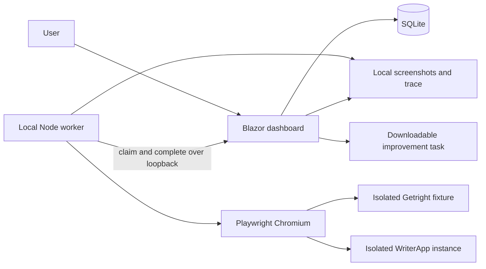

# Architecture

## Current implementation



`src/Getright.Dashboard` hosts interactive server-rendered pages and a small JSON
API. `RunStore` serializes mutations and uses SQLite WAL with parameterized SQL.
Schema version 2 retains run snapshots, feedback JSON and the private worker lease,
and adds local application profiles. Startup migrates schema 1 transactionally,
preserving legacy runs without target/identity fields. Newer schemas are rejected
instead of being downgraded. Future schema changes require explicit migrations.

`config/catalog.json` is copied into the dashboard build and published output.
Rebuild after editing it. Test definitions are snapped into queued runs, so later
catalogue edits cannot change historical reproduction steps. The server and
worker allowlist executable adapters; simply changing a draft flag cannot make
an unimplemented test execute.

`worker/src/index.mjs` claims and runs one job at a time. It has no inbound HTTP
listener, shell-command endpoint or model-driven browser action selection. The
demo adapter is repeatable source code. A fresh browser context isolates each run.
Step screenshots and a Playwright trace are written to the shared evidence root
before completion is submitted. Failed launches and browser failures report a
failed run; they do not manufacture passing steps or human acceptance.

The running dashboard's assembly informational version identifies the demo build.
.NET includes the source revision when building from a committed Git checkout.
This identifies the local fixture. The WriterApp launcher supplies a unique
assembly version and retains a source receipt; preflight checks its actual version
endpoint and development identity. Runs freeze that profile, and the worker checks
it again before creating data and after the workflow. Passing completions must
match the frozen target/build/account and include the created document identity.
The source receipt records if the source was dirty; a commit hash alone does not
identify those uncommitted changes. Worktree build/launch orchestration is milestone 2.

## Data and state

```text
data/
  getright.db             # runs, feedback and application profiles, schema version 2
  keys/                   # local ASP.NET keys, protected with DPAPI on Windows
  evidence/<run-id>/
    open.png
    edit.png
    save.png
    reopen.png
    trace.zip
  writerapp/<instance-id>/ # isolated WriterApp database, config and build receipt
```

Automated state: `queued → running → passed | failed | interrupted`.

Acceptance state: `pending | accepted | improvements-requested`.

Review decisions apply only to completed runs. Adding feedback marks that run as
improvements requested in the same transaction as feedback persistence. Reviews
can be changed; test results, test snapshots and existing feedback are retained.
Each new run starts pending. Review audit history and feedback editing are future
work. History displays the latest 12 runs per test; all runs remain in SQLite.

Claims use a private lease that is never returned by ordinary run reads. Duplicate
claims, mismatched leases, duplicate completions and incomplete passing results
are rejected. Dashboard restart invalidates running leases. Claims sweep work
older than ten minutes into interrupted. There is no heartbeat or automatic retry
yet, so adapters must stay within the lease duration.

## Trust boundary

This is a **single trusted local user's development tool**. The server validates
loopback peers, loopback Host headers and same-origin browser requests, including
WebSocket origins. The worker accepts only a loopback HTTP dashboard origin.
Evidence routes serve only files referenced by that run. Files are not exposed as
a general static directory. No arbitrary command, repository path or script can
be submitted through the API.

Local processes with access to the dashboard and data directory are trusted. The
lease is a concurrency control, not user authentication. The application is not
suitable for LAN access, reverse-proxy publishing or multi-user hosting without
authentication, authorization, CSRF/session design and authenticated worker leases.

Evidence and traces can contain application content and session data. Keep them
in ignored local storage, use dedicated UAT accounts, and sanitize any exported
material before sharing. GitHub Actions runs only the isolated demo and does not
upload traces or screenshots from live target applications.

## Planned Codex integration

The [official Codex SDK](https://learn.chatgpt.com/docs/codex-sdk) supports
programmatic coding workflows. The [app server](https://learn.chatgpt.com/docs/app-server)
is the alternative for richer embedded conversations and approvals. The starter
exports prompts and does not install or invoke either integration.

Before adding an Implement action: persist an editable job draft, bind it to a
configured repository, create a dedicated worktree at a recorded base commit,
run Codex with explicit permissions, capture events and exit status, build and
launch that worktree's application, verify runtime build identity and rerun the
same test with new isolated data. Preserve the original run, feedback, job and
rerun links. Never mark generated code or a rerun accepted automatically.
