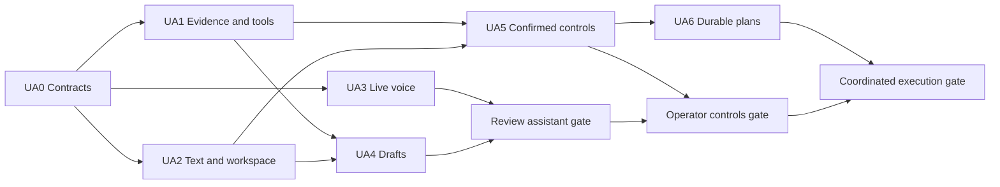

# Getright UAT copilot implementation plan

Build a text and voice copilot in the Run Workspace that can explain a live or
completed run, help a reviewer record feedback, and coordinate approved UAT
work across runs and jobs. The first release should make a single review session
easier. Later releases add confirmed controls and durable multi-case plans.

## Milestones and dependencies

| ID | Milestone | Required for completion | Release |
| --- | --- | --- | --- |
| UA0 | Contracts and baseline | Current Getright integration baseline | Foundation |
| UA1 | Evidence and agent tools | UA0 | Review assistant |
| UA2 | Text and workspace UI | UA0. Integrate with UA1 for release | Review assistant |
| UA3 | GPT-Live voice | UA0. Integrate with UA1 and UA2 for release | Review assistant |
| UA4 | Feedback, coverage and job drafts | UA1 and UA2 | Review assistant |
| UA5 | Confirmed run and job controls | UA1 and UA2 | Operator controls |
| UA6 | Durable UAT plans | UA5 command and queue contracts | Coordinated execution |
| UA7 | End-to-end validation and rollout | UA1–UA6, in release increments | All releases |

After UA0, split the work into three tracks. Dashboard backend owns UA1, Blazor
UI owns UA2, and the OpenAI transport owns UA3. UA2 can use fixture tool results.
UA3 can use a stub dispatcher and a microphone test page, then connect to the
workspace and real dispatcher. Keep transport and UI changes in separate files
and integrate them through the agreed session interface.

UA4 and UA5 can then run in parallel. UA4 owns draft editors and proposal flows.
UA5 owns the command dispatcher, confirmation, and execution receipts. Agree on
the shared card format in UA0 and use one owner for changes to `RunStore` and its
schema. UA6 plan validation and a fake event source can start during UA5. Connect
the coordinator to live queues after UA5 has proven idempotency and recovery.
Write and run UA7 tests alongside each track. Final release checks follow the
integration order shown above.

## Architecture and data ownership

- **Blazor workspace.** Mount the copilot beside the tested app and existing
  review controls. Pass stable application, suite, test, run and step IDs as
  context. Keep a selected historical run pinned. Resolve phrases like “this
  step” from the visible selection and clarify ambiguous matches before acting.
- **Dashboard copilot service.** Use one dispatcher for text and voice. Give the
  model named tools with strict argument and result schemas. Resolve IDs,
  enforce scope, and construct evidence links on the server. Derive facts from
  frozen run snapshots, worker activity, and existing readiness and review
  services. Label diagnostic hypotheses and report unavailable evidence explicitly.
- **Execution.** Queue work through `ApplicationSetup` and existing job and
  live-browser services. Keep worker claims, leases, Playwright execution,
  fixture isolation, build verification and immutable completion in their
  current paths. Improve and rerun through the existing dedicated Git worktree
  flow. Record the base commit, resulting commit and actual running build.
- **Persistence.** Keep live conversation and unsaved drafts scoped to the
  workspace session. Persist confirmed command receipts, existing feedback and
  proposals, and approved plan state. Store identifiers, timestamps, outcome
  codes and links needed for audit. Keep raw audio, provider keys, credentials
  and raw tool payloads out of Getright storage and logs. Use additive SQLite
  migrations and preserve absent fields on legacy runs as unknown.
- **Trust boundary.** Keep session creation and command execution under
  Getright's existing loopback and same-origin checks. Treat conversation,
  workflow text and application output as untrusted input. Allowlisted tools
  return bounded structured fields. Keep screenshots, traces, raw response
  bodies and tested-app content local in the initial releases. Users open
  evidence through Getright's existing authorized routes.

[Getright architecture](architecture.md) · [Contracts](contracts.md) ·
[Live browser](live-browser.md) · [Improvement jobs](improvement-jobs.md)

## UA0 Contracts and baseline

1. Record the implementation base revision and validate the dashboard and
   worker baseline. Use the current manifest, configured workflow and build
   receipt contracts as integration points. Include an older saved run in
   compatibility fixtures.
2. Specify `WorkspaceScope`, `ToolResult`, `EvidenceReference`,
   `ActionProposal`, `CommandReceipt` and the text/voice session interface.
   Define event ordering, typed error codes, provenance fields and limits.
   Separate provider session identity from local action identity.
3. Publish fixture JSON for a paused run, a failed preflight, an assertion
   failure, a passing run with pending acceptance, retired evidence, and a
   job with a linked rerun. Agree on the tool and feature-flag matrix.

**Exit gate.** The three tracks can build against the same fixture contracts.
Baseline failures and assumptions are recorded with their owning component.

## UA1 Evidence and agent tools

1. Implement read tools for case search, readiness and qualification, run
   summary, exact step and expected result, worker and pause state, run
   comparison, and job status. Return evidence references only after resolving
   them against the run and step. Use the comparison view for visual inspection.
2. For comparison, align stable step IDs and show each run's build, fixture,
   workflow revision, assisted steps, automated result and human acceptance.
   Identify changes in test definitions or setup that limit comparability.
3. Connect a configurable OpenAI Responses backend for text reasoning. Pass
   selected context and bounded tool results. Add cancellation, request
   budgets, a provider seam for synthetic tests, and metadata-only diagnostics.
   Use fresh tool reads for current status. Let server code resolve all links.

**Exit gate.** Synthetic-provider tests show grounded answers for historical,
paused, failed and passed runs, including unavailable build or evidence. Cross-run
references, unknown tool calls and out-of-scope IDs fail cleanly.

## UA2 Text and workspace UI

1. Add a collapsible copilot panel with scope chips, text input, responses,
   evidence cards and a shared draft/action card surface. Start in Run Workspace
   and use deep links to the run, comparison and job pages. Provide read-only
   control-room entry for case discovery and worker status.
2. Keep the dock and review controls accessible with the copilot open. Preserve
   the selected run and draft while polling. Distinguish loading, active work,
   paused steps, retained review, pending acceptance and provider failure.
3. Make keyboard navigation, focus order, status announcements and narrow
   layout part of the component tests and browser review.

**Exit gate.** Desktop and narrow layouts support an end-to-end text review.
Changing the selected run is explicit, and older cards still identify their
original target. A provider failure leaves manual review usable.

## UA3 GPT-Live voice

1. Add an opt-in voice setting and same-origin session endpoint. Exchange the
   browser's WebRTC offer through `POST /v1/live/sessions` using a dashboard-side
   OpenAI project key. Use `gpt-live-1` as a configurable voice model. Gate
   session creation on configuration and bound session count and duration.
2. Use **client delegation** with a server-side connection so voice can use the
   same dispatcher and context rules as text. Assemble a delegation request
   from the transcript events and pinned workspace state. Return concise,
   sanitized results to voice and render structured cards in Blazor. Assign the
   server sole ownership of tool execution. Bind results to their delegation and
   session so stale replies cannot act on a newer selection.
3. Provide start, visible listening state, mute, stop, captions and text fallback.
   Handle microphone denial, interruption, dropped transport and idle expiry.
   End the provider session and release tracks on stop or navigation. Treat
   interruption as a conversation event. Confirmed Getright work continues under
   its own lifecycle and can be cancelled through its normal control.
4. Disclose that microphone audio goes to OpenAI during an active session. Track
   voice duration, backend usage and latency. Verify project access with a short,
   opt-in live test before enabling the feature. [GPT-Live WebRTC](https://developers.openai.com/api/docs/guides/voice-webrtc?api=live) · [Delegation](https://developers.openai.com/api/docs/guides/live-delegation?delegation-mode=client#configure-client-delegation) · [Server-side controls](https://developers.openai.com/api/docs/guides/voice-server-controls?api=live)

**Exit gate.** Text and voice give the same recorded facts and evidence links.
A real microphone check verifies speech, captions, interruption, mute, and stop.
Permission denial and provider disconnect return the workspace to usable text.

## UA4 Feedback, coverage and job drafts

1. Draft editable observations and requested outcomes from typed or spoken
   input. Show the exact run, step, fixture, tested build and evidence. Keep the
   draft local to the review session until the reviewer chooses to save. Show
   that saving feedback sets **Improvements requested** on the selected run.
2. Prepare an editable improvement job from saved feedback through the existing
   draft workflow. Link original evidence, job status and the verified rerun.
   Show automated outcomes and human decisions independently for both runs.
3. Identify coverage gaps from the catalogue, drafts, qualification state and
   recent evidence. Turn requested gaps into editable suite proposals through
   the existing generation and apply flow. Applying a proposal creates drafts
   subject to the current implementation and qualification gates.

**Exit gate.** Dictation and text produce reviewable drafts. Saving against
an older run remains anchored to that run. Preparing a job leaves it awaiting
an explicit implementation action, and new case drafts remain disabled.

## UA5 Confirmed run and job controls

1. Add action cards for queueing or rerunning a runnable case, advancing one
   paused step, running remaining steps, cancelling a run or job, finishing a
   live review, and starting a prepared improvement job. Keep acceptance in the
   existing human review UI. Expose the exact target, effect and mode on the card.
2. Bind confirmation to a server-issued proposal ID with canonical parameters,
   expected state or revision and expiry. Recheck target readiness and state
   when confirmed. For stepped control, bind to the exact paused step and reuse
   the existing serialized release. A stale card returns a refreshable reason.
3. Give each confirmed command a stable idempotency key. For durable mutations,
   persist the action receipt and run or job link with the mutation. For live
   actions, reconcile retries with the current session and step state. Treat an
   uncertain outcome as a reconciliation case, so reconnecting or repeating a
   transcript cannot silently repeat a command.

**Exit gate.** Tests cover duplicate confirmations, lost responses, cross-tab
races, target/build changes, stale steps, cancellation and revision conflicts.
One confirmed action produces one result or a clear rejection. Voice and text
reach the same server-side checks.

## UA6 Durable UAT plans

1. Let the copilot propose a bounded plan and show it for approval. Start with a
   serial list of runnable cases and simple conditions such as “run B after A
   passes.” Freeze case IDs, definition and binding fingerprints, run mode,
   target constraints, dependencies, stop rules and the maximum work budget.
   Show expected build constraints before approval. Validate isolated readiness
   and configuration again immediately before each queue operation.
2. Add a dashboard-owned coordinator backed by SQLite. Persist plan and step
   states, dependency decisions, command IDs and linked run/job IDs. Reconcile
   from authoritative queue and run/job state on restart and when events arrive.
   Use transactional transitions and stable per-step command IDs so a crash
   between queueing and acknowledgment can be recovered without duplicate work.
3. Surface planned, running, waiting, blocked, completed and cancelled states.
   Pause when a binding drifts, the plan needs a human decision, or a stop rule
   triggers. On cancellation, prevent future launches and show the disposition of
   linked work. Resume only after current state is checked. Include a human
   handoff for explicit Codex implementation and a separate rerun review.
4. Report grouped progress and link to each run's evidence. Let the UI subscribe
   to plan changes and show milestones in the active voice session when useful.
   Continue approved work through Getright's queue when the panel or call closes.

**Exit gate.** Prove a passing branch, a failing stop, readiness drift,
dashboard restart, worker lease loss, and cancellation with disposable cases.
Reconciliation produces one run per approved plan step. A completed plan can
contain runs still awaiting human acceptance.

## UA7 Validation and rollout

| Gate | Required evidence |
| --- | --- |
| Review assistant | Release build and existing worker checks. Synthetic tool tests plus browser coverage for run grounding, evidence, draft persistence and provider failure. Opt-in GPT-Live microphone test on the local dashboard. |
| Operator controls | Targeted `smoke:steps`, `smoke:live-dock`, `smoke:quick-review`, `smoke:jobs` and `smoke:suites` runs, plus copilot-specific stale, duplicate, rejection and recovery tests. |
| Coordinated execution | Disposable multi-case smoke tests across queue recovery and restart. Demonstrate the job handoff and linked verified rerun with synthetic execution. Run an opt-in real cycle against an isolated configured app and retain pending human acceptance. |

For each gate, record the dashboard build, worker version, fixture, results and
review evidence. Include prompt-injection attempts through application or
workflow text, microphone and provider failures, legacy runs, and regression
checks with the copilot disabled. Track tool correctness, first-answer latency,
voice duration and provider errors. Require correct target and review-state
attribution for every release fixture and zero unauthorized or duplicate
mutations in the failure suite. Set latency and usage budgets from the local
pilot before widening use.

Ship review, voice, confirmed actions and plans behind separate configuration
flags. When disabling plans, stop scheduling new steps and surface existing
run/job links for reconciliation. Keep operational guidance with the release,
including key setup, voice data flow, audit lookup and restart recovery.

## End-to-end acceptance scenario

Using the isolated Virtual Company permissions case, open a stepped run and ask
what the current step is proving. Confirm one step and inspect its evidence.
Dictate a review observation, edit it, and save it to the exact run and step.
Prepare a job and explicitly start it. Verify the worker records the base and
resulting commits and that the linked rerun tested the resulting build on a new
fixture. Ask for a comparison. The agent should explain the before and after
results, point to the evidence, and report the rerun's pending acceptance.

Approve a short regression plan from the same workspace, then end the call.
Reopen Getright and verify that plan progress and linked results can be recovered
from the dashboard. Complete human review through the existing review controls.
